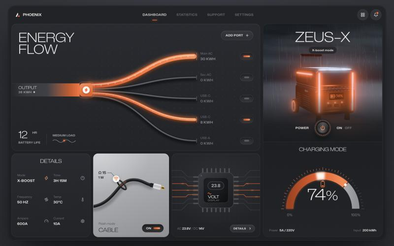
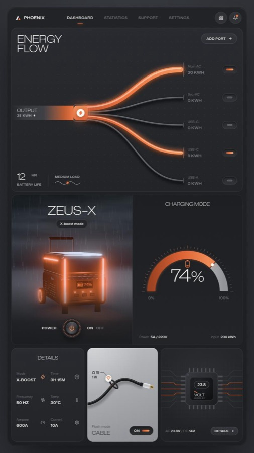
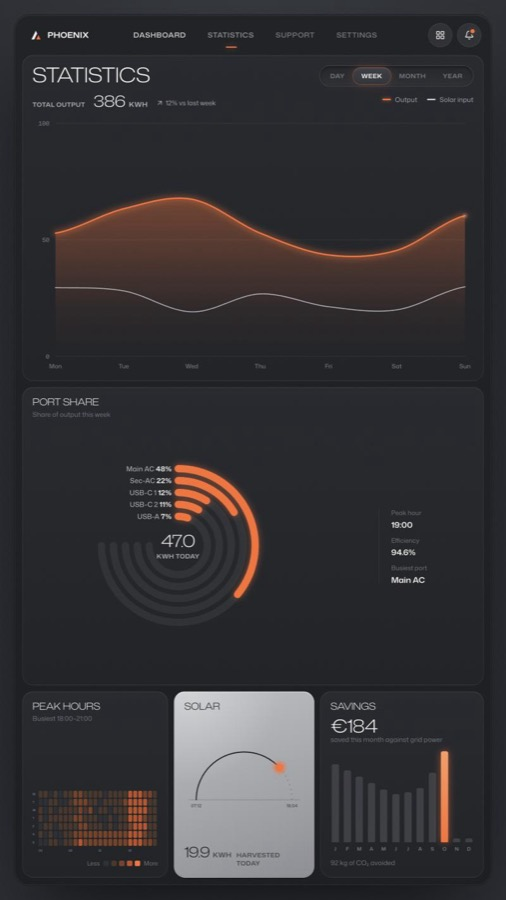
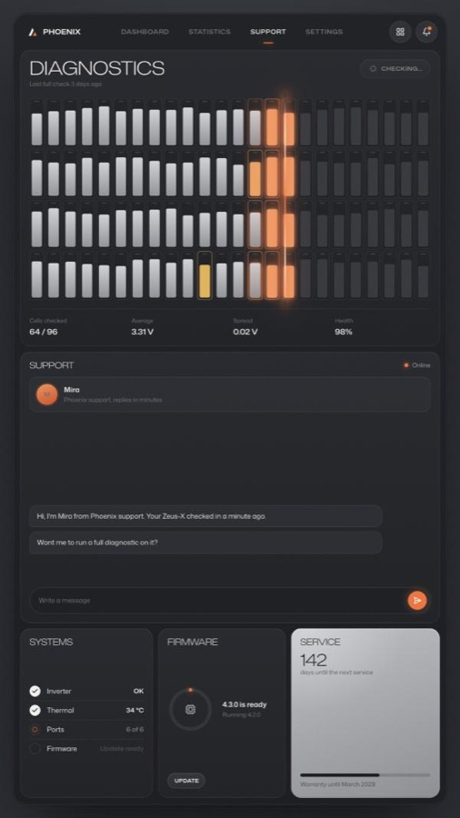
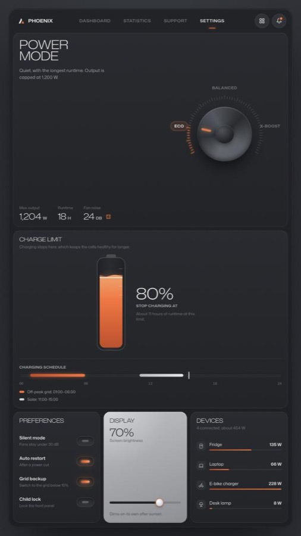

# Phoenix: animated energy dashboard

An IoT energy-management dashboard with a live 3D power station, energy that
physically flows through the cables, and one orchestrated power-on sequence.
Four screens (Dashboard, Statistics, Support, Settings), joined by a scan of
light that prints each new screen as it sweeps down. Pure front end: no
backend, no API keys, no integrations.



| Dashboard | Statistics | Support | Settings |
| --- | --- | --- | --- |
|  |  |  |  |

Design reference: [IoT Energy Management Dashboard ✦ Phoenix](https://dribbble.com/shots/24882387-IoT-Energy-Management-Dashboard-Phoenix)
by HALO LAB on Dribbble. This project rebuilds that shot in code. The 3D scene,
illustrations, motion and code are original.

## Run it

```bash
npm install
npm run dev
```

Open http://127.0.0.1:5190. Needs Node 20.19+ or 22.12+.

## Controls

| Key | What it does |
| --- | --- |
| `1`–`4` | Switch screens |
| `R` | Replay the boot sequence |
| `P` | Switch the station off and on |
| `D` | Play the scripted tour of all four screens (about 70 seconds) |
| `Esc` | Stop the tour |

Everything is clickable too. On the dashboard: port switches, cables (hover for
their share), add a port, drag the 3D station, the power knob. Statistics: the
period switch morphs the chart, and the chart has a hover readout. Support: run
a diagnostic from the card or the chat, install the firmware. Settings: turn
the power-mode dial, drag the charge limit or the brightness slider.

URL options:

- `?reel` lays the board out in a fixed 9:16 frame, scaled to fit the window.
- `?demo` plays the tour as soon as the page loads; `?demo=statistics` (or any
  comma-separated mix of `dashboard`, `statistics`, `support`, `settings`)
  plays just those scenes, which is handy for one short clip per screen.
- `?zoom=off` keeps the demo camera still (useful if your screen recorder zooms on its own).
- `?motion=full` plays every animation even when the OS asks for reduced motion.

## Recording a reel

The tour drives the real interface with a drawn cursor while a camera zooms in
on whatever is happening. The dashboard boots, ports switch on, a port is added,
the station is spun, powered off and struck back to life by lightning. Then
Statistics morphs its chart, Support scans all 96 battery cells while Mira
reports back, and Settings turns the power-mode dial and drags the charge
limit. The full tour runs about 70 seconds; each screen alone is 12–23.

**Vertical (Reels, TikTok, Shorts):**

1. Open `http://127.0.0.1:5190/?reel&demo&motion=full` in Chrome and make the window full screen
   (or `?reel&demo=support&motion=full` for a single screen).
2. Press `Cmd+Shift+5`, choose *Record Selected Portion*, and draw the box around the 9:16 frame.
3. Start recording and press `D` to restart the take.

The frame is 840×1493 CSS pixels, so a Retina screen records it at roughly
1080×1920 with the interface about 1.3× larger than on desktop.

**Landscape:** open `http://127.0.0.1:5190/?demo&motion=full` full screen and record the whole window.

## How it's built

- **React 19 + TypeScript + Vite**
- **GSAP 3** (with SplitText and ScrambleText) for every timeline
- **three.js** for the station: physical materials, a storm-sky shader, GPU
  rain, procedural lightning and bloom
- **Mona Sans** (variable width): the wide display style is the same family as the body text

Where things live:

| File | What's in it |
| --- | --- |
| `src/motion/director.ts` | The whole boot and power choreography, in one table |
| `src/motion/demo.ts` | The scripted tour: drawn cursor, camera and one scene per screen |
| `src/motion/screens.ts` | Screen switching and the scan transition |
| `src/screens/` | Statistics, Support and Settings |
| `src/components/EnergyFlow.tsx` | The energy flow: cables, particles, ports |
| `src/scene/DeviceScene.ts` | The 3D station, storm, rain and lightning |
| `src/components/ChargingGauge.tsx` | The charging gauge |
| `src/styles/tokens.css` | Colors, radii and type |

### Making it yours

- **Ports and their loads:** `START_PORTS` in `EnergyFlow.tsx`. Cable thickness,
  particle speed, battery life and the load label all follow the numbers.
- **The accent color:** `--ember` in `tokens.css`, plus `EMBER` in `DeviceScene.ts`.
- **Timing:** each component registers `intro`, `powerOn` and `powerOff`
  segments. `director.ts` places them on one timeline, so retiming the whole
  sequence means editing one list.
- **Glow:** `--power` on the root element runs from 0 (off) to 1 (on). Every
  glow in the CSS is multiplied by it, which is why the whole board fades in
  and out together.

## License

MIT for the code, see [LICENSE](LICENSE). The visual design is HALO LAB's; credit them if you publish something built on it.
